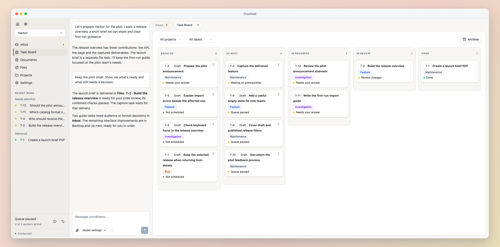
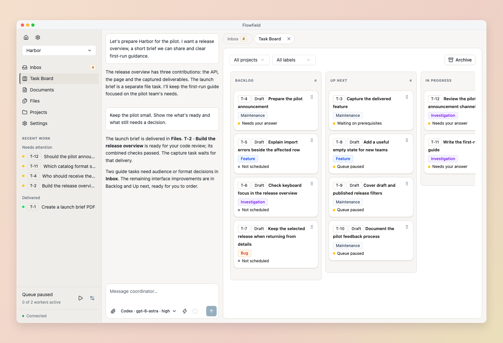
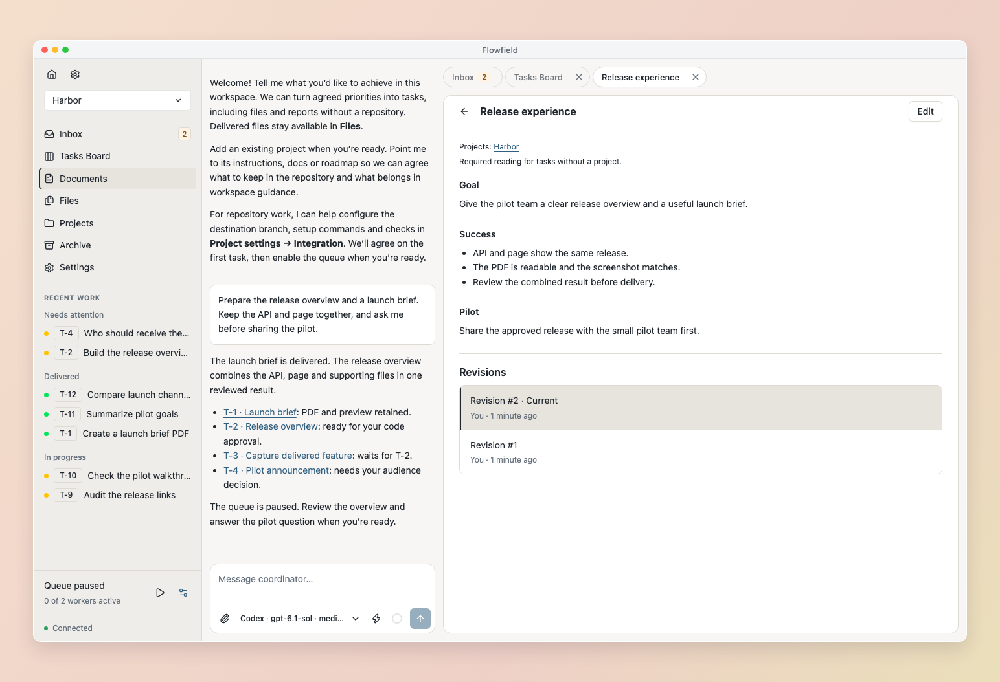
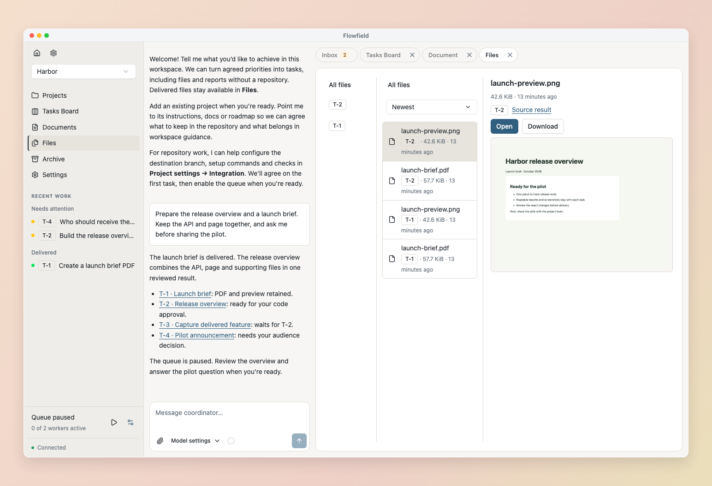
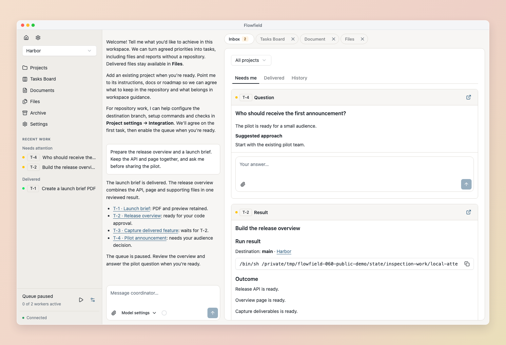
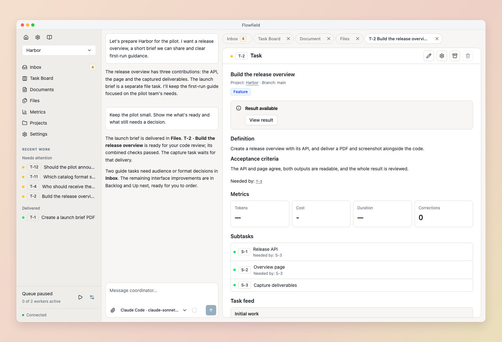
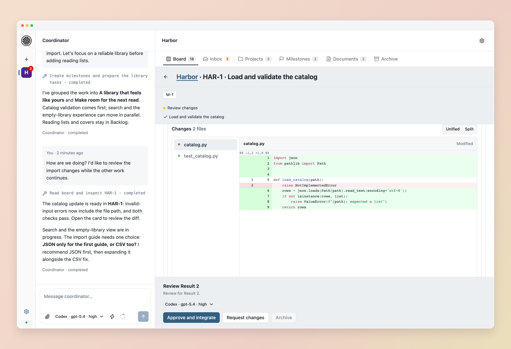

<h1 align="center">Flowfield</h1>

<p align="center"><strong>Stop being the glue between your agents.</strong></p>
<p align="center">A workspace for you and your coding agents.<br>One conversation to plan. Tasks that hold the work. One Inbox for decisions.</p>

<p align="center">
  <a href="https://flowfield.sh">Website</a> · <a href="https://docs.flowfield.sh/getting-started">Get started</a> · <a href="https://docs.flowfield.sh">Documentation</a>
</p>

<p align="center">
  <a href="https://pypi.org/project/flowfield-core/"></a>
  <a href="https://github.com/flowfield-sh/flowfield-core/actions/workflows/tests.yml"></a>
</p>



Working with coding agents can mean bouncing between threads, repeating decisions and checking what needs you.

**Flowfield organizes that work around tasks and an Inbox.** Plan through one coordinator conversation while tasks hold the context, worker activity and results. Questions and approvals come back to one place. You decide which code ships.

Flowfield runs locally and works with **Codex, Claude Code and Pi**. Choose independently for the Coordinator, Workers and Reviewer.

## Get started

Install [uv](https://docs.astral.sh/uv/getting-started/installation/) and sign in to a supported coding harness, then:

```sh
uv tool install flowfield-core
flowfield serve
```

Open [localhost:8765](http://127.0.0.1:8765), create a workspace and choose its agents. Add existing repositories for code work, or start with a report or file task. See [Getting started](https://docs.flowfield.sh/getting-started) for the walkthrough or [Installation](https://docs.flowfield.sh/installation) for requirements and alternatives.

## How does Flowfield work?

**💬 Plan through one conversation**<br>Bring a rough idea, a wall of feedback or a one-off request to the Coordinator. Group related changes into focused tasks, agree on what they should accomplish, and keep planning while workers carry them out.

**🗂️ Follow tasks across projects**<br>Bring your API, application and documentation into one workspace. Each task keeps its scope, activity and results. Move cards on the board to set priorities and link tasks that depend on each other. Reports and files can have tasks without a repository.

**📚 Keep decisions where workers can use them**<br>Maintain shared guidance with the Coordinator and select the documents each task needs. Flowfield reviews guidance changes before work and approval; results preserve the exact revisions used.

**⚡ Build in parallel**<br>Workers carry out independent tasks in separate checkouts using your tools and checks. Dependent tasks wait for the work they need. Larger tasks can split into subtasks that come back as one result for review.

**📥 Handle decisions in one Inbox**<br>Answer questions, grant permissions and review code through Needs me. Eligible work continues after you respond. Find completed results in Delivered and earlier responses in History.

**🔎 Review the result and decide what ships**<br>The Reviewer checks the result against the task and can request corrections. Inspect or run the code, then approve it for your local branch. Reports and files finish after configured review and remain available in Files. Ask the Coordinator to run, push or publish a result when you’re ready.

## Screenshots

<table>
  <tr>
    <td width="33%" align="center"><a href="docs/images/readme/board.png"></a><br><strong>Tasks</strong></td>
    <td width="33%" align="center"><a href="docs/images/readme/documents.png"></a><br><strong>Documents</strong></td>
    <td width="33%" align="center"><a href="docs/images/readme/files.png"></a><br><strong>Files</strong></td>
  </tr>
  <tr>
    <td align="center"><a href="docs/images/readme/inbox.png"></a><br><strong>Inbox</strong></td>
    <td align="center"><a href="docs/images/readme/task.png"></a><br><strong>Task history</strong></td>
    <td align="center"><a href="docs/images/readme/review.png"></a><br><strong>Code review</strong></td>
  </tr>
</table>

## Contributing

Bug reports, feature requests and feedback are welcome. See [CONTRIBUTING.md](https://github.com/flowfield-sh/flowfield-core/blob/main/CONTRIBUTING.md) for issue reporting and contribution policy. Report vulnerabilities through [private security reporting](https://github.com/flowfield-sh/flowfield-core/security/advisories/new).

### Build from source

Requires Python 3.12+, uv, Node 24+, pnpm 11.19.0 and Bun 1.3.11. Set `FLOWFIELD_BUILD_BUN` to the Bun executable before `make setup`.

```sh
make setup
pnpm --dir web build
uv run flowfield serve
```

Flowfield is licensed under the [Apache License 2.0](https://github.com/flowfield-sh/flowfield-core/blob/main/LICENSE).
