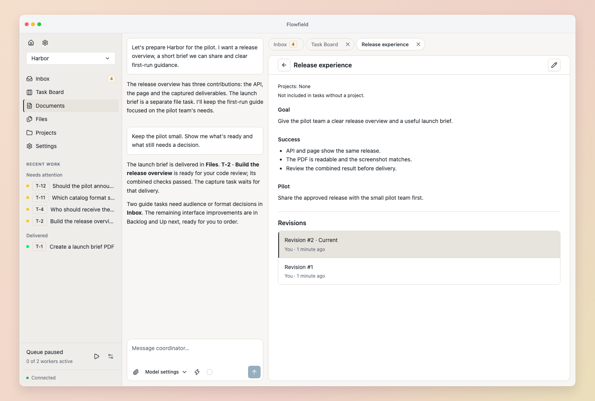
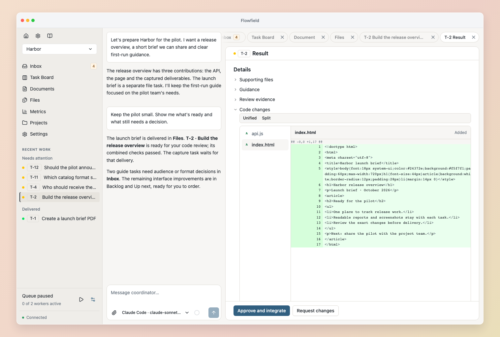

<h1 align="center">Flowfield</h1>

<p align="center"><strong>Ship software. Not slop.</strong></p>
<p align="center">A workspace for you and your coding agents.<br>Work through the idea, keep the context, and build across projects without losing the plot.</p>

<p align="center">
  <a href="https://flowfield.sh">Website</a> · <a href="https://docs.flowfield.sh/getting-started">Get started</a> · <a href="https://docs.flowfield.sh">Documentation</a>
</p>

<p align="center">
  <a href="https://pypi.org/project/flowfield-core/"></a>
  <a href="https://github.com/flowfield-sh/flowfield-core/actions/workflows/tests.yml"></a>
  <a href="LICENSE"></a>
</p>


## Fast code needs somewhere to go.

The idea is in one conversation. The API work is in another. A worker needs an answer, the frontend is waiting on a change, and the reason you chose this approach is buried twenty messages back.

**Flowfield gives that work a home.** Plan with the Coordinator, keep shared knowledge in versioned documents, and let workers build focused tasks in your existing repositories. Questions and reviews come back to one Inbox. You decide what ships.

Open source. Runs locally. Works with **Codex, Claude Code and Pi**—choose independently for the Coordinator and workers.

## Keep the thinking with the work.

**💬 Shape the idea** — Talk through the problem with the Coordinator. Turn decisions into clear tasks and milestones while the work continues beside the conversation.

**🗂️ Connect your projects** — Bring the API, frontend and tooling into one workspace. Share guidance, documents and priorities; link tasks across repositories when one outcome depends on another.

**📚 Give workers the right context** — Select required sources and supporting references. Prepared tasks keep their exact document revisions, and newer source revisions stay visible for review.

**⚡ Build in parallel** — Run independent tasks in separate Git checkouts with your own tools and checks. Dependencies hold later work until its prerequisites are complete.

**📥 Know what needs you** — Find questions, blockers and results in Inbox. Keep each task’s progress, answers and evidence together in its feed.

**🔎 Own the finish** — Inspect the diff, try the exact result, ask for another pass, or approve delivery to your branch. Approval stays tied to the code you reviewed.


## One feature. Three repositories. One place to follow it.

Suppose you’re adding a booking flow: an API, a customer site and a check-in tool.

1. **Work out the contract.** Discuss the behavior with the Coordinator and save the shared rules in a document.
2. **Make the work concrete.** Prepare a task in each project, with the relevant sources and dependencies. Keep the rollout together in a milestone.
3. **Let workers build.** Independent tasks run in parallel. Answer a worker’s question once; Flowfield continues the task with that answer.
4. **Review what came back.** Inspect results and checks, request changes where needed, and approve each exact code result for delivery.

When the plan changes, update the shared knowledge and reconcile affected work with the Coordinator. The board shows where things stand; the task feeds preserve how they got there.

## A closer look

<table>
  <tr>
    <td width="50%"><a href="docs/images/documents.png"></a></td>
    <td width="50%"><a href="docs/images/code-review.png"></a></td>
  </tr>
  <tr>
    <td align="center"><strong>Context that stays with the work</strong><br>Shared documents. Exact revisions.</td>
    <td align="center"><strong>A finish you can inspect</strong><br>Changes, checks and your approval.</td>
  </tr>
</table>

[Explore the product →](https://flowfield.sh/product/)

## Bring your repos. Bring your agents.

Install and sign in to [Codex CLI](https://developers.openai.com/codex/cli/), [Claude Code](https://code.claude.com/docs/en/setup) or [Pi](https://pi.dev), then:

```sh
uv tool install flowfield-core
flowfield serve
```

Open [localhost:8765](http://127.0.0.1:8765), create a workspace and add your existing projects. Or adopt a repository from your terminal:

```sh
flowfield workspace create "My workspace"
flowfield project init /path/to/your/repo --workspace WORKSPACE_ID
```

Use the ID printed by `workspace create`. Choose a Coordinator model, start a conversation, and configure worker settings when you’re ready to run tasks. See [Getting started](https://docs.flowfield.sh/getting-started) for the walkthrough and [Installation](https://docs.flowfield.sh/installation) for the pip alternative.

Your repositories keep their tools, conventions and history. Workers use separate Git checkouts; approved code is delivered to the configured branch while protecting your working changes. Flowfield runs on your machine and uses your installed coding harnesses and their accounts.

Prefer planning from your own coding-agent session? [Connect a standalone agent](https://docs.flowfield.sh/agents/overview#standalone-conversations) through MCP.

## Go deeper

[Workspaces](https://docs.flowfield.sh/workspaces) · [Coordinator](https://docs.flowfield.sh/coordinator) · [Documents](https://docs.flowfield.sh/documents) · [Workers and review](https://docs.flowfield.sh/tasks) · [CLI](https://docs.flowfield.sh/cli)

<details>
<summary><strong>Build from source</strong></summary>

Requires Python 3.12+, uv, Node 24+, pnpm 11.19.0 and Bun 1.3.11. Set `FLOWFIELD_BUILD_BUN` to the Bun executable before `make setup`.

```sh
make setup
pnpm --dir web build
uv run flowfield serve
```

</details>

See [CONTRIBUTING.md](CONTRIBUTING.md) for issue reporting and contribution policy. Report vulnerabilities through [private security reporting](https://github.com/flowfield-sh/flowfield-core/security/advisories/new).

[Apache License 2.0](LICENSE).
