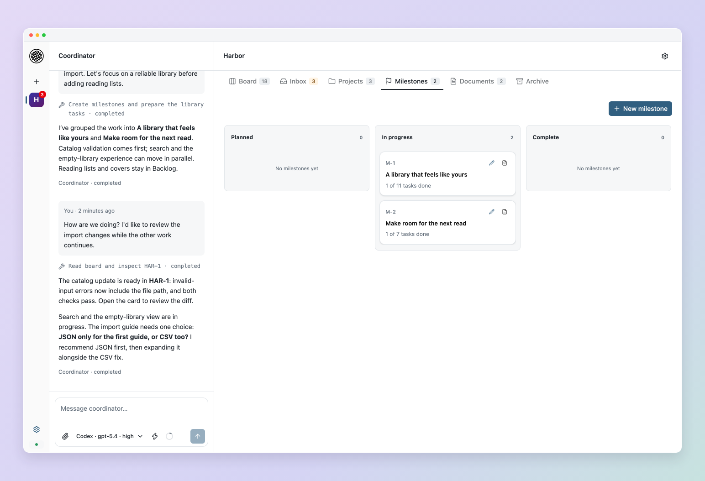

<h1 align="center">Flowfield</h1>

<p align="center"><strong>Ship software. Not slop.</strong></p>
<p align="center">A workspace for you and your coding agents.<br>Work through the idea, keep the context, and build across projects without losing the plot.</p>

<p align="center">
  <a href="https://flowfield.sh">Website</a> · <a href="https://docs.flowfield.sh/getting-started">Get started</a> · <a href="https://docs.flowfield.sh">Documentation</a>
</p>

<p align="center">
  <a href="https://pypi.org/project/flowfield-core/"></a>
  <a href="https://github.com/flowfield-sh/flowfield-core/actions/workflows/tests.yml"></a>
  <a href="LICENSE"></a>
</p>


## Fast code needs somewhere to go.

The idea is in one conversation. The API work is in another. A worker needs an answer, the frontend is waiting on a change, and the reason you chose this approach is buried twenty messages back.

**Flowfield gives that work a home.** Plan with the Coordinator, keep shared knowledge in versioned documents, and let workers build focused tasks in your existing repositories. Questions and reviews come back to one Inbox. You decide what ships.

Flowfield works with **Codex, Claude Code and Pi**, with more harness support coming. Choose independently for the Coordinator and workers.

## Get started

Install [uv](https://docs.astral.sh/uv/getting-started/installation/) and sign in to a supported coding harness, then:

```sh
uv tool install flowfield-core
flowfield serve
```

Open [localhost:8765](http://127.0.0.1:8765), create a workspace and add your existing repositories. See [Getting started](https://docs.flowfield.sh/getting-started) for the walkthrough or [Installation](https://docs.flowfield.sh/installation) for requirements and alternatives.

## Keep the thinking with the work.

**💬 Shape the idea**<br>Talk through the problem with the Coordinator. Turn decisions into clear tasks and milestones while the work continues beside the conversation.

**🗂️ Connect your projects**<br>Bring the API, frontend and tooling into one workspace. Share guidance, documents and priorities; link tasks across repositories when one outcome depends on another.

**📚 Give workers the right context**<br>Select required sources and supporting references. Prepared tasks keep their exact document revisions, and newer source revisions stay visible for review.

**⚡ Build in parallel**<br>Run independent tasks in separate Git checkouts with your own tools and checks. Dependencies hold later work until its prerequisites are complete.

**📥 Know what needs you**<br>Find questions, blockers and results in Inbox. Keep each task’s progress, answers and evidence together in its feed.

**🔎 Own the finish**<br>Inspect the diff, try the exact result, ask for another pass, or approve delivery to your branch. Approval stays tied to the code you reviewed.

## A closer look

<table>
  <tr>
    <td width="33%" align="center"><a href="docs/images/readme/board.png"></a><br><strong>Board</strong></td>
    <td width="33%" align="center"><a href="docs/images/readme/documents.png"></a><br><strong>Documents</strong></td>
    <td width="33%" align="center"><a href="docs/images/readme/milestones.png"></a><br><strong>Milestones</strong></td>
  </tr>
  <tr>
    <td align="center"><a href="docs/images/readme/inbox.png"></a><br><strong>Inbox</strong></td>
    <td align="center"><a href="docs/images/readme/task.png"></a><br><strong>Task conversation</strong></td>
    <td align="center"><a href="docs/images/readme/review.png"></a><br><strong>Code review</strong></td>
  </tr>
</table>

[Explore the product →](https://flowfield.sh/product/)

## Go deeper

[Workspaces](https://docs.flowfield.sh/workspaces) · [Coordinator](https://docs.flowfield.sh/coordinator) · [Documents](https://docs.flowfield.sh/documents) · [Workers and review](https://docs.flowfield.sh/tasks) · [CLI](https://docs.flowfield.sh/cli)

Prefer planning from your own coding-agent session? [Connect a standalone agent](https://docs.flowfield.sh/agents/overview#standalone-conversations) through MCP.

<details>
<summary><strong>Build from source</strong></summary>

Requires Python 3.12+, uv, Node 24+, pnpm 11.19.0 and Bun 1.3.11. Set `FLOWFIELD_BUILD_BUN` to the Bun executable before `make setup`.

```sh
make setup
pnpm --dir web build
uv run flowfield serve
```

</details>

## Contributing

Bug reports, feature requests and feedback are welcome. See [CONTRIBUTING.md](CONTRIBUTING.md) for issue reporting and contribution policy. Report vulnerabilities through [private security reporting](https://github.com/flowfield-sh/flowfield-core/security/advisories/new).

Flowfield is licensed under the [Apache License 2.0](LICENSE).
